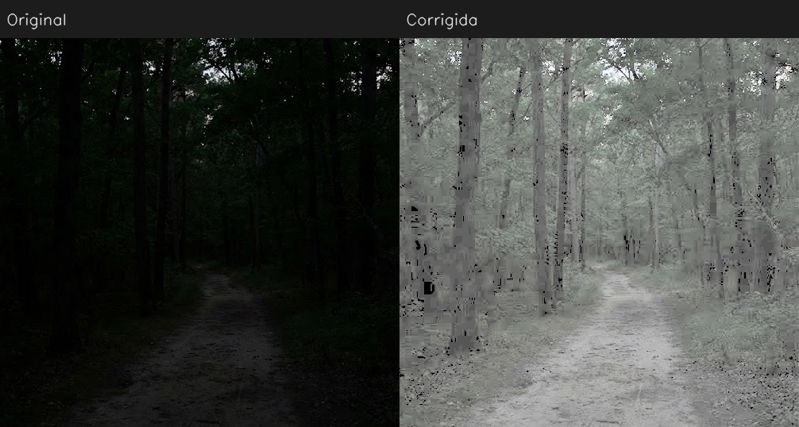
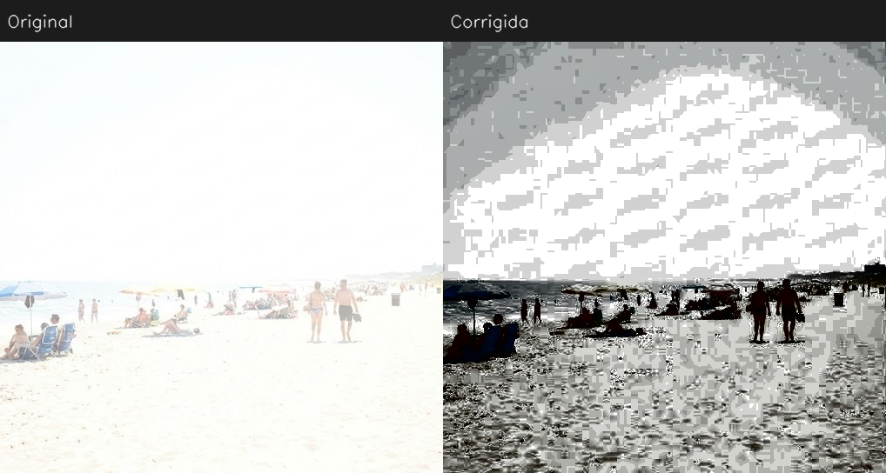

# Otimizador Automático de Imagens

Diagnóstico e correção automática de exposição com **Python, NumPy e OpenCV**,
desenvolvido para o [desafio da Rocketseat](https://app.rocketseat.com.br/projects/otimizador-automatico-de-imagens).
O programa identifica fotos escuras ou claras demais, aplica correção gama
adaptativa e melhora o contraste local, sem ajustes manuais.

## Executar

Requer Python **3.10 ou superior**. Na pasta do projeto:

```bash
python3 -m venv .venv
source .venv/bin/activate
python -m pip install -r requirements.txt
python main.py
```

No Windows, ative com `.venv\Scripts\activate` e use `python` no lugar de
`python3`. Em Debian/Ubuntu, se a criação do ambiente informar que
`ensurepip` não está disponível, instale o pacote `python3-venv` correspondente
à sua versão do Python. Se você já usa `uv`, pode criar o ambiente com
`uv venv --seed .venv`.

O ambiente `.venv` desta entrega já contém as dependências. Para executar
diretamente no Linux, sem ativá-lo:

```bash
.venv/bin/python main.py
```

Sem argumentos, o script processa os PNGs em `imagens/`. Os caminhos padrão
são relativos à localização do script, permitindo executá-lo a partir de
outro diretório. Para outras fotos ou outro destino:

```bash
python main.py minha_foto.jpg outra_foto.png --saida minhas_correcoes
python main.py --help
```

Argumentos de entrada e `--saida` relativos são resolvidos a partir do
diretório atual. As entradas devem ser arquivos individuais; a leitura
usa BGR de 8 bits, convertendo imagens em cinza e descartando transparência.

## Resultados

Para cada imagem, são salvos:

- `<nome>_corrigida.png`: imagem processada na resolução original.
- `<nome>_comparacao.png`: original à esquerda e corrigida à direita,
  com legendas e sem redimensionamento.
- `relatorio.json`: caminhos, diagnóstico, gama, média, desvio padrão e
  histogramas de 256 níveis, antes e depois, para todo o lote.

O console mostra a correção aplicada e a mudança no brilho médio.
Os originais são preservados. Reexecutar atualiza as saídas do mesmo nome;
entradas que gerariam nomes de saída iguais são recusadas. Erros interrompem
o lote com código de saída 1; saídas de imagens anteriores podem já existir.
Não é necessário abrir janelas ou ter uma interface gráfica.

Resultados obtidos com as imagens fornecidas (brilho na escala de 0 a 255):

| Imagem | Diagnóstico | Gama | Média antes | Média depois |
| --- | --- | ---: | ---: | ---: |
| `image-1.png` | Superexposta | 0,0200 | 250,84 | 180,35 |
| `image-2.png` | Subexposta | 5,2754 | 10,04 | 125,55 |

### Floresta: subexposição



### Praia: superexposição



## Como funciona

1. **Diagnóstico:** `cv2.cvtColor` converte BGR para cinza; `np.mean` calcula
   o brilho médio e `cv2.calcHist` produz o histograma.
2. **Decisão:** média menor que 100 indica subexposição; maior que 200 indica
   superexposição. Valores de 100 a 200, inclusive, preservam a imagem.
3. **Gama adaptativo:** uma busca binária avalia a média prevista pelo
   histograma e procura aproximá-la de 128. A busca é limitada a `[0.02, 10]`;
   preto e branco absolutos não podem ser alterados pela lei de potência.
4. **Correção:** uma tabela de 256 posições é calculada com NumPy em
   `float32`, limitada com `np.clip`, convertida para `uint8` e aplicada com
   `cv2.LUT`. O pipeline atua apenas no canal Y do espaço YCrCb, mantendo
   Cr/Cb para não amplificar pequenas diferenças entre canais de cor.
5. **Contraste local:** CLAHE com limite 2 e grade 8×8 é misturado em 50%
   com a luminância corrigida. Imagens de luminância constante dispensam
   essa etapa. A reconstrução BGR pode limitar cores fora do intervalo.
6. **Comparação:** `np.hstack` e `np.vstack` montam o PNG antes/depois.

A fórmula segue a convenção do enunciado:

```text
saída = 255 × (entrada / 255) ** (1 / gama)

gama > 1 → clareia
gama < 1 → escurece
gama = 1 → identidade
```

`ajustar_gama(imagem, gamma=1.0)` também está disponível em `otimizador.py`
para aplicar a LUT diretamente aos canais BGR. `otimizar(imagem)` retorna
a imagem corrigida e suas métricas, usando a correção de luminância.

> [!NOTE]
> A correção revela informação existente; não reconstrói detalhes perdidos.
> Cerca de 27% dos pixels da praia já são branco puro. Nas duas imagens,
> ajustes fortes também evidenciam blocos, quantização e ruído presentes
> na entrada. O alvo de brilho é uma heurística, não uma garantia de
> restauração fotográfica ou de qualidade para qualquer cena.

## Testes

```bash
python -m unittest discover -s tests -v
```

Os testes cobrem os limiares do diagnóstico, a fórmula e o sentido do gama,
ausência de overflow, imagens normais e extremas, preservação de cor,
as duas fotos reais, os PNGs comparativos, erros de arquivos e colisões de
saída. Usam somente `unittest` e as dependências do projeto.

Ambiente validado nesta entrega: Python 3.14.4, NumPy 2.5.5 e OpenCV 4.14.0.

## Estrutura

```text
.
├── main.py             # CLI, leitura e gravação
├── otimizador.py       # Diagnóstico, gama e contraste
├── requirements.txt
├── imagens/            # Exemplos originais
├── resultados/         # Imagens corrigidas, comparações e relatório
├── tests/              # Testes de processamento e integração
└── docs/superpowers/   # Design e plano de implementação
```

Referências técnicas: [potência no NumPy](https://numpy.org/doc/stable/reference/generated/numpy.power.html)
e [equalização e CLAHE no OpenCV](https://docs.opencv.org/4.x/d5/daf/tutorial_py_histogram_equalization.html).
